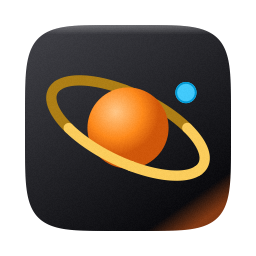

<div align="center">



# orbit

**A native macOS client for the [`mo`](https://github.com/tw93/mole) CLI.**

Go · MyGo · WKWebView — no Electron, no bundled runtime.

[](https://github.com/real-jacket/orbit/actions/workflows/ci.yml)
[](LICENSE)
[](#requirements)
[](go.mod)

</div>

> The application is **orbit**. It is a desktop client for the upstream `mo` CLI.
> The bundle is named `MoleStudio` on disk; "orbit" is the product name in the UI.

---

## What it is

orbit puts a desktop face on [`tw93/mole`](https://github.com/tw93/mole) — the open-source
`mo` CLI that frees disk space and refreshes macOS caches. It reads real hardware telemetry from the
Mach kernel, drives `mo` as a subprocess, and renders a warm, low-glare control surface instead of a
terminal.

The `mo` binary is **not** bundled or vendored. The app resolves it at runtime from `PATH`
(`/opt/homebrew/bin/mo`, `/usr/local/bin/mo`, `~/.local/bin/mo`, `~/.mole/mo`) and shells out to it,
so you always run the upstream version you installed.

## Features

| Module | Backed by | What it does |
| --- | --- | --- |
| **Deep Clean** · Earth | `mo clean` | Caches, logs, browser render caches, Xcode `DerivedData`, package-manager caches |
| **AI Care** · Moon | `mo clean --ai-care` | Stale AI CLI binaries, render caches, expired agent worktrees, SQLite compaction |
| **Uninstaller** · Mars | `mo uninstall` | Removes app bundles plus their leftover support files, with "keep personal data" |
| **Optimize** · Mercury | `mo optimize` | Refreshes caches, rebuilds QuickLook/icon caches, vacuums system SQLite databases |
| **Astrolabe** · disk analyzer | `mo analyze --json` | Treemap of the CLI overview, with a fresh CLI scan when a directory is opened |
| **Live Status** · Sun | `mo status` | Process table with CPU, memory and power draw |
| **Purge** | `mo purge`, `mo installer` | Removes rebuildable project artifacts and stale installer packages |
| **History & Whitelist** | `mo history`, `mo clean --whitelist` | Cleanup audit log and protected-path management |

Beyond the module list:

- **Path & Safety Inspector** — selecting any category reveals the exact subdirectories, their sizes,
  a rebuild-cost assessment, one-click Finder reveal, and direct whitelist protection.
- **Proportional volume bars** — every row carries an inline bar relative to total scan size.
- **Pre-execution diff** — deletions are previewed as a structured sheet (paths, safety tier, Trash
  recovery checkpoint) before anything runs.
- **Dry-run by default** — `dryRunMode` defaults to `true`.
- **Menu bar presence** — an orbit-mark status item whose popover is the same tray UI (clean, health check, caffeinate, quit).
- **Live local scan** — installed apps, leftover Library paths, and large files are sampled on the Mac and pushed into the UI over the JS bridge.
- **Three uninstall modes** — Standard, Complete, and Cache-only, with per-path selection before anything moves to the Trash.
- **Treemap drill-down** — disk tiles open into their child directories.
- **Live telemetry** — `statfs`, memory, and `/bin/ps` sampled on a 1.5 s timer.

## Requirements

- macOS 13 (Ventura) or later
- Go 1.27+ (the module declares `go 1.27.3`)
- The [MyGo](https://github.com/egoist/mygo) CLI for packaging and dev runs:

  ```bash
  go install github.com/egoist/mygo/cmd/mygo@v0.6.4
  ```

- The `mo` CLI on `PATH`:

  ```bash
  brew install mole
  mo --version
  ```

## Build and run

```bash
git clone https://github.com/real-jacket/orbit.git
cd orbit

make             # go build -v -o mole-studio .
make run         # build and launch straight from the checkout
make test        # unit test suite
make vet         # go vet
make check       # vet + test, the same gate CI runs
make dev         # MyGo dev server with live reload (needs the `mygo` CLI)
make app         # app bundle plus a .dmg, both under build/
make app-nodmg   # app bundle only
make doctor      # check the Go / MyGo / packaging toolchain
make help        # list every target
```

`make app` produces an ad-hoc-signed bundle whose UI is MyGo's embedded copy of
`Resources/src-ui/`, plus a versioned `.dmg` beside it. Both land in a per-platform
subdirectory — on Apple silicon `build/darwin-arm64/MoleStudio.app` — because `mygo build`
always nests its output under `<goos>-<goarch>/`. Drag the bundle to `/Applications` to keep
it around.

**Sandboxed shells.** If the module cache or build cache is not writable, `go build` fails with a
permission error. Point all three at a scratch directory first:

```bash
export GOPATH=/tmp/gopath GOMODCACHE=/tmp/gopath/pkg/mod GOCACHE=/tmp/gocache
export PATH="/tmp/gopath/bin:$PATH"   # where `go install` put the mygo CLI
```

## Architecture

The app is a Go program that embeds MyGo, which in turn hosts the same single-file
`Resources/src-ui/index.html` UI in a `WKWebView`. The Swift implementation this port started from is
gone from the tree — it was removed in the porting commit and lives on in git history
(`git show adea952:Sources/MoleStudio/MoleStudioApp.swift`). The right-hand column of the tables below
says which Swift file each Go file was written from, so the mapping stays useful.

| Go package | Responsibility | Ported from |
| --- | --- | --- |
| `internal/model` | Domain types: modules, safety tiers, clean categories, retention windows, optimize tasks; the selection/toggle arithmetic of the view model | `Sources/MoleStudio/Models/MoleModels.swift`, `Engine/MoleViewModel.swift` |
| `internal/power` | Thermal (`NSProcessInfo` over purego/objc), memory-pressure and battery snapshot via `sysctl` and `ioreg` | `Sources/MoleStudio/PowerStatus.swift` |
| `internal/scanner` | The local scan: installed apps, orphaned leftovers, large files, installer packages, clean catalogs, AI Care bands, the home treemap, the process table | `Engine/RealMacSystemScanner.swift`, `Engine/CatalogScanning.swift`, `Engine/OrphanScanning.swift`, `Engine/OrphanSignatures.swift` |
| `internal/analyze` | Resolves `mo` and runs `mo analyze --json`, shaping the result into treemap tiles | `Engine/MoleAnalyzeBridge.swift`, `Engine/MoleCLIRunner.swift` (binary resolution) |
| `internal/trayicon` | Draws the 18pt menu-bar template image from an analytic description instead of AppKit | `MoleStudioApp.swift` (`configureStatusItem`) |

The app shell itself is a handful of files in `package main` at the repository root, because that is
where MyGo wants the entry point:

| File | Responsibility | Ported from |
| --- | --- | --- |
| `main.go` | `func main() { run() }` — nothing else | `@main enum MoleStudioMain` |
| `app.go` | `run`/`buildUI`: `mygo.NewWindow`, the tray, the popover flyout, the application menu, the 1.5 s telemetry ticker, and `OnActivate`/`OnClose` handling | `MoleStudioApp.swift` (`AppDelegate`, `UILocator`) |
| `bridge.go` | `NativeBridge.Dispatch`: one switch over `payload["action"]` that reproduces the Swift `WKScriptMessageHandler` branch for branch | `MoleStudioApp.swift` (`NativeBridgeController`) |
| `preload.go` | The `PreloadScript` injected before the page's own scripts: the `moleNative` shim, the `isNativeMacApp`/`isMenuBarPopover` flags, and the drag-region CSS | `MoleStudioApp.swift` (WKWebView configuration) |
| `push.go` | Go → page: serialises payloads and calls the page's `window.onNative*` globals in every open window | `MoleStudioApp.swift` (`evaluateJavaScript` call sites) |
| `theme.go` | `mygo.Theme` plus a `preferences.json` in the user data directory, replacing `UserDefaults` | `MoleStudioApp.swift` (`applyTheme`) |

Two documents go deeper: [`docs/go-port.md`](docs/go-port.md) is the porting record — file-by-file
mapping, the decisions behind it, and the known gaps against the Swift build — while
[`docs/mygo-migration.md`](docs/mygo-migration.md) is the framework analysis that justified the move.

The frontend is untouched by the port. `preload.go` restores the `window.webkit.messageHandlers.moleNative`
object the page expects to post to (MyGo has no `WKScriptMessageHandler`, so it forwards to
`NativeBridge.Dispatch` instead), so the UI still posts the same actions — `revealInFinder`, `copyText`,
`killProcess`, `trashRealPaths`, `requestRealSystemScan`, `requestDiskAnalyze`, `requestRealTelemetry`,
`toggleCaffeinate`, `startWindowDrag`, `toggleWindowZoom`, `setTheme`, the `menubar*` family — and still
receives the same callbacks (`onNativeRealScanComplete`, `onNativeRealTelemetry`, `onNativeDiskAnalyze`,
`switchModule`, `openConfirmSheet`). Four actions the page can send — `addWhitelist`,
`restoreTrashSnapshot`, `runDoctorReCheck`, `setFanMode` — fall through to `default` in both the Swift and
the Go switch; they were never implemented natively.

## App icon

The icon is **rendered from code**, not checked in as an opaque bitmap. `scripts/generate-app-icon.swift`
draws the v10 brand mark with CoreGraphics and emits every size `iconutil` needs. The Go build never runs
it — the rendered outputs are committed under `assets/` — so it is only needed when you change the mark.
Call it directly; there is no Makefile target for it:

```bash
swift scripts/generate-app-icon.swift icns   assets/AppIcon.icns
swift scripts/generate-app-icon.swift single assets/AppIcon-256.png 256
swift scripts/generate-app-icon.swift sheet  /tmp/icon-preview.png
```

MyGo reads a PNG, not an `.icns`: `mygo.json` points at `assets/icon.png` (a copy of the 256 px mark) and
MyGo renders `Contents/Resources/AppIcon.icns` from it while packaging. That PNG is the **bundle** icon
only — the menu bar mark is drawn at runtime by `internal/trayicon`, so the two are independent. Do not
list an icon or an `.icns` again under `resources`: MyGo reserves those bundle names and rejects the
build.

The mark matches the sidebar brand SVG: a `#27272a → #09090b → #7c2d12` squircle plate, a terracotta
planet lit from the upper left (`#fff7ed → #fdba74 → #ea580c → #7c2d12`), a ring split so the far half
passes behind the planet and the near half crosses in front, and an ice-blue companion (`#38bdf8`).

Three details worth knowing if you edit the renderer:

- **Small sizes keep the same mark, with thicker strokes.** At 16–32px the planet, ring, and companion
  are enlarged so the silhouette still reads in the Dock.
- **The output is dithered.** An 8-bit gradient across a large dark surface bands visibly; a ±2 noise
  layer removes the steps and is invisible at 100%.
- **The background is a superellipse, not a rounded rectangle.** Apple's icon grid uses a continuous
  corner curve, so the body is drawn as an n=5 squircle inset 100px in a 1024px canvas (the standard
  824×824 body).

## Project status

This is an early-stage client, and the Go port is mid-flight. Being explicit about what is and is not
wired up:

- **The UI in `Resources/src-ui/index.html` is the shipping UI**, carried over unchanged. In a
  `mygo build` bundle MyGo embeds it; `make run` and `mygo dev` serve it from disk.
- **The samplers are real and tested.** `internal/scanner` walks the disk for apps, leftovers, large
  files, installers and clean catalogs; `internal/power` reads thermal state, memory pressure and
  the battery from `sysctl`/`ioreg`; `internal/analyze` shells out to `mo analyze --json`.
  `go test ./...` covers the numeric and payload-shape behaviour of all three.
- **The bridge is implemented, not stubbed.** `NativeBridge.Dispatch` handles all 16 branches the Swift
  switch handled: Finder reveal, clipboard, process killing (SIGTERM then SIGKILL), moving paths to the
  Trash, `qlmanage -r cache` for Optimize, `caffeinate -d -i -t 7200` for Keep Awake, theme persistence,
  window zoom and drag, and the menu-bar commands that eval a script into the page. Four actions the page
  can post — `addWhitelist`, `restoreTrashSnapshot`, `runDoctorReCheck`, `setFanMode` — fall through to
  `default` exactly as they did in Swift, because the page keeps that state itself.
- **CI builds the Go app.** `.github/workflows/ci.yml` runs `go vet` / `go test` / `go build`, installs the
  pinned `mygo` CLI, packages with `mygo build --skip-dmg`, and then asserts the bundle is real — the
  Mach-O executable, a valid `Info.plist`, `Contents/Resources/AppIcon.icns` that unpacks with
  `iconutil`, and the embedded frontend marker in the binary. A second job gates `gofmt`, `go vet`, and a
  clean `mygo generate` (so `mygo.ts` can never be stale in a PR).
- **Some CLI flags shown in the UI are aspirational.** `mo clean --ai-care`, `--retention` and
  `--band` do not exist in `mo` 1.56.1. Treat those strings as design intent for the AI Care module,
  not as working commands.
- **CPU load, memory, disk free space, installed apps, leftovers, installers, and build artifacts are sampled on this Mac.**
  Temperature shown next to CPU is still estimated from load.

## Safety model

The app deletes files, so the guardrails are the point:

- Protected categories (`tier == "protected"`) cannot be selected — the toggle is a no-op.
- Every destructive action is previewed before execution.
- Dry-run is on by default.
- The whitelist is read from `~/.config/mole/whitelist`, the same file `mo` uses.
- Cleanup history is `mo`'s own (`mo history`). orbit does not keep a second audit log, so there is
  nothing to trust besides the upstream record.

## Relationship to upstream

This project is an independent GUI client. It is **not** affiliated with or endorsed by
[tw93/mole](https://github.com/tw93/mole). It contains no upstream source code and does not
redistribute the `mo` binary — it invokes your installed copy as a subprocess. Upstream `mo` is
licensed GPL-3.0, and this client is licensed GPL-3.0 to match.

## Contributing

See [CONTRIBUTING.md](CONTRIBUTING.md). Bug reports and feature requests have templates under
`.github/ISSUE_TEMPLATE/`.

## License

[GPL-3.0](LICENSE). Copyright (C) 2026 real-jacket.
