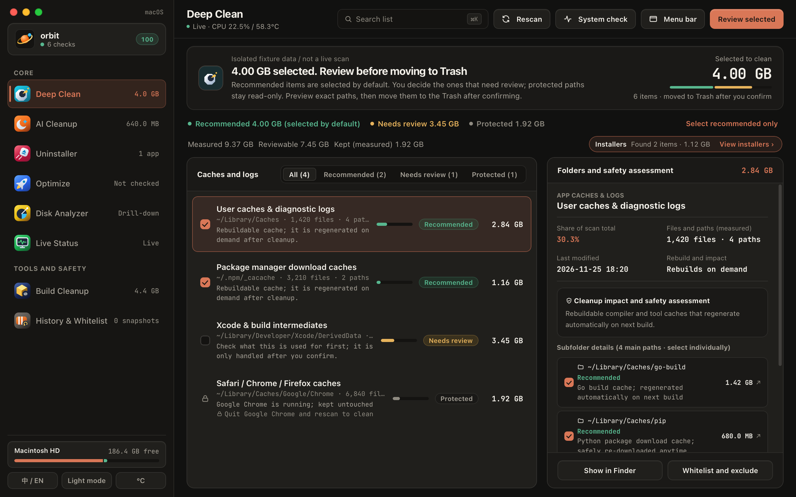
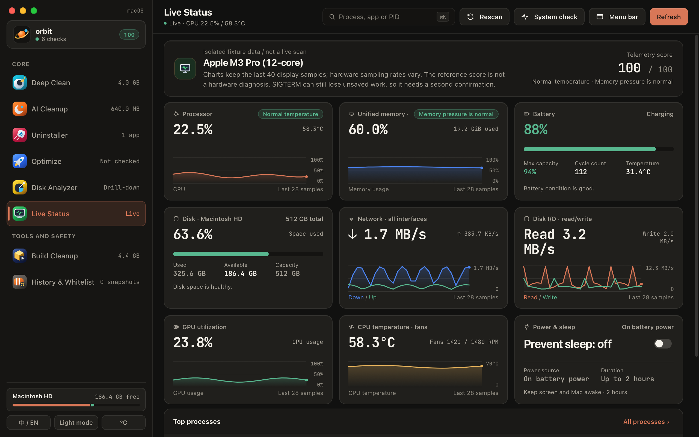
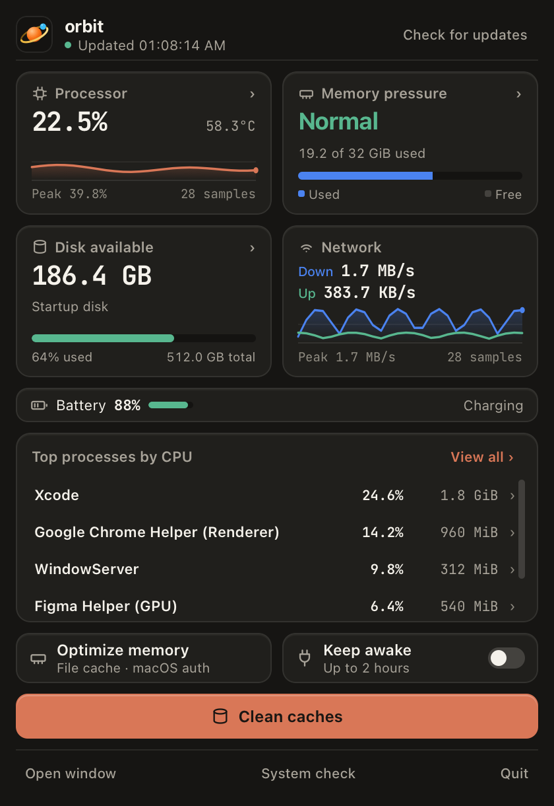
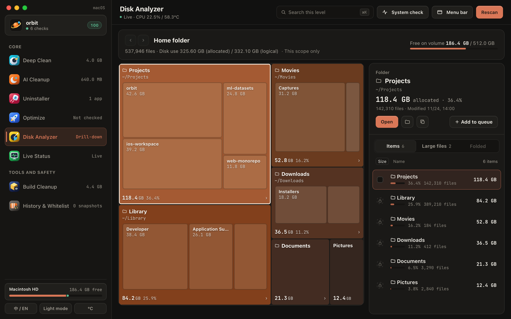

<div align="center">


# orbit

**A fast, safety-first macOS disk cleaner, uninstaller, and system monitor.**

Native Go · MyGo · WKWebView — no Electron, no bundled runtime.

**English** · [简体中文](README.zh-CN.md)

[](https://github.com/real-jacket/orbit/releases/latest)
[](https://github.com/real-jacket/orbit/actions/workflows/ci.yml)
[](#requirements)
[](go.mod)
[](LICENSE)
[](https://awesomemygo.dev/apps/orbit)

<br>

<picture>
  <source media="(prefers-color-scheme: dark)" srcset="assets/screenshots/clean-dark.png">
  <source media="(prefers-color-scheme: light)" srcset="assets/screenshots/clean-light.png">
  
</picture>

</div>

---

## Install

Download the latest universal disk image (Apple silicon & Intel) from [GitHub Releases](https://github.com/real-jacket/orbit/releases/latest):

1. Open `orbit-<version>-universal.dmg` and drag **`orbit.app`** into **`/Applications`**.
2. Releases are signed with a fixed self-signed certificate (`orbit Self-Signed`) so Full Disk Access persists across updates, but are not Apple-notarized. On first launch, right-click `orbit.app` → **Open**, or run:
   ```bash
   xattr -dr com.apple.quarantine /Applications/orbit.app
   ```
3. Future updates are delivered in-app automatically (Ed25519-verified from GitHub Releases).

> **Note:** The app bundle is `orbit.app`, while the bundle identifier remains `com.mymoles.mole-studio` so permissions and settings carry over seamlessly from earlier `MoleStudio` builds.

---

## What orbit Does

orbit inspects what is taking up disk space on your Mac and helps you reclaim it without guesswork: system and developer caches, old AI coding tool versions, apps and their leftovers, rebuildable build artifacts, installer packages, and large files. It also includes an interactive disk treemap and real-time hardware telemetry in both the main window and a background menu bar popover.

| Module | What it does |
| --- | --- |
| **Deep Clean** | Scans user caches, logs, browser profiles, package managers, Xcode, Gradle/CocoaPods, and macOS user state. Running apps' caches are automatically protected until quit; installer packages appear inline when found. |
| **AI Cleanup** | Checks Claude Code, Cursor Agent, Copilot CLI, and Claude Desktop releases against launchers, running processes, and open file handles. Keeps the current + spare version; models, sessions, and worktrees stay protected. |
| **Uninstaller** | Three modes (**Standard**, **Complete**, **Cache only**) with per-path checkboxes, user-level LaunchAgent stop/restore, config reference audit, leftover discovery (with shared-CLI protection such as `~/.docker` when `docker`/OrbStack is installed), and Apple silicon app slimming. |
| **Optimize** | Checks 19 macOS maintenance tasks before touching anything: 10 runnable tasks with execution receipts and one-click undo where reversible; tasks requiring `sudo` or irreversible deletion are listed transparently and never run. |
| **Disk Analyzer** | In-process treemap and directory drill-down showing both allocated and logical sizes, hard-link deduplication, current-level search, folded small-item inspection, and a batch Trash queue. |
| **Live Status** | Real-time CPU, unified memory breakdown, GPU, AppleSMC temperatures and fan speeds, network throughput, disk I/O, battery health, 2-hour keep-awake toggle, and a searchable/pinnable process drawer. |
| **Build Cleanup** | Finds rebuildable build artifacts (`node_modules`, `target`, `.venv`, etc.) across default or custom project folders (`~/.config/mole/purge_paths`) plus leftover `.dmg`/`.pkg` installers. |
| **History & Whitelist** | Snapshot-backed Trash restore with live Trash verification, status filters (`All / Restorable / Needs check`), native Finder folder picker for `~/.config/mole/whitelist`, wildcard badges, and one-click cleanup for invalid rules. |

---

## Interface Gallery

<table>
  <tr>
    <td width="64%" valign="top">
      <picture>
        <source media="(prefers-color-scheme: dark)" srcset="assets/screenshots/status-dark.png">
        <source media="(prefers-color-scheme: light)" srcset="assets/screenshots/status-light.png">
        
      </picture>
      <p align="center"><sub><b>Live Status</b> — CPU, memory, GPU, SMC temps/fans, disk I/O, network & processes</sub></p>
    </td>
    <td width="36%" valign="top">
      <picture>
        <source media="(prefers-color-scheme: dark)" srcset="assets/screenshots/menubar-dark.png">
        <source media="(prefers-color-scheme: light)" srcset="assets/screenshots/menubar-light.png">
        
      </picture>
      <p align="center"><sub><b>Menu Bar Mode</b> — Stays resident in the menu bar when closed or quit from the Dock</sub></p>
    </td>
  </tr>
  <tr>
    <td colspan="2" valign="top">
      <picture>
        <source media="(prefers-color-scheme: dark)" srcset="assets/screenshots/analyze-dark.png">
        <source media="(prefers-color-scheme: light)" srcset="assets/screenshots/analyze-light.png">
        
      </picture>
      <p align="center"><sub><b>Disk Analyzer</b> — Interactive treemap with allocated/logical sizes and multi-level drill-down</sub></p>
    </td>
  </tr>
</table>

### Key Highlights

- **Menu bar background mode** — Closing the main window (`⌘W`) or quitting from the Dock (`⌘Q`) hides the window and Dock icon while keeping orbit running quietly in the menu bar. Click the tray icon to reopen anytime, or choose **Quit** in the popover / `⌘⌥Q` to exit completely.
- **Actionable System Check** — Summarizes Full Disk Access, thermal state, memory pressure, disk headroom, battery health, and SIP in a top verdict card with abnormal items surfaced first and direct one-click actions (jump to Deep Clean / Disk Analyzer, open macOS Privacy settings, release file cache, or inspect top processes).
- **Path & Safety Inspector** — Every category expands to individual subpaths with sizes, rebuild-cost notes, one-click Finder reveal, and direct whitelist exclusion.
- **Bilingual & Dual Theme** — Instant Chinese / English switching and Dark / Light themes in the sidebar; respects reduced motion.

---

## Safety Model

orbit moves files on your Mac, so every guardrail is explicit and verified:

1. **Three-tier classification** — Every discovered item is marked **Recommended** (rebuildable & idle, selected by default), **Needs review** (opt-in with plain reason), or **Protected** (read-only; running apps explain what to quit, active CLI dotdirs stay untouched).
2. **Frozen preview before execution** — Clicking the primary action opens a confirmation sheet listing exact paths and freezes the submitted selection until execution completes.
3. **Trash with receipts, never `rm -rf`** — Cleanups move items to macOS Trash and wait for native receipts before updating the UI. History records real paths for restore and verifies live Trash presence; orbit never empties the Trash.
4. **No silent privilege escalation** — Admin-owned apps open in Finder so macOS handles authorization; `sudo` maintenance tasks are listed transparently and not run. The only admin prompt is the optional **Optimize Memory** (`/usr/sbin/purge`) file-cache release triggered explicitly by you.
5. **Reversible settings & user whitelist** — Reversible optimize tasks save prior values for one-click undo. Protected paths are stored in `~/.config/mole/whitelist` (compatible with Mole).

---

## Requirements & Building from Source

- **macOS 13 (Ventura)** or later
- **Go 1.27+** (`go.mod` declares `go 1.27.3`; `GOTOOLCHAIN=auto` downloads it automatically on first build)
- **Node.js 24+** (development/tests only; zero runtime dependency in the shipped app)
- **[MyGo](https://github.com/egoist/mygo) CLI** (optional; Make targets run the pinned `v0.6.4` via `go run` if not preinstalled)

```bash
git clone https://github.com/real-jacket/orbit.git
cd orbit

make run            # Build and launch a stable orbit.app bundle (recommended for daily dev)
make dev            # Live-reload dev server (rebuilds on index.html or Go edits)
make app            # Package orbit.app + .dmg under build/<goos>-<goarch>/
make app-nodmg      # Package orbit.app only
make check          # Run go vet, Go unit tests, and Node UI/i18n regression checks
make test-ui-webkit # Run 587 isolated macOS WebKit layout, theme & interaction checks
make mole-sync      # Diff ported cleanup rules against upstream tw93/mole
make doctor         # Verify local Go / MyGo / packaging toolchain
```

<details>
<summary><b>Build notes & sandboxed shells</b></summary>

- `make run` builds `build/darwin-arm64/orbit.app` so macOS tracks Full Disk Access against a stable bundle instead of ephemeral `go-build` binaries. `make run-raw` is reserved for narrow bridge debugging.
- The first build may download the `go1.27.3` toolchain (~240 MB once) unless already installed via `gvm` or your Go toolchain cache.
- In read-only/sandboxed shells, redirect Go caches before building:
  ```bash
  export GOPATH=/tmp/gopath GOMODCACHE=/tmp/gopath/pkg/mod GOCACHE=/tmp/gocache
  export PATH="/tmp/gopath/bin:$PATH"
  ```

</details>

---

## CI & Releases

- **CI ([`.github/workflows/ci.yml`](.github/workflows/ci.yml))** runs on a single `macos-latest` runner per push/PR: `gofmt`, `go vet`, `mygo generate` freshness check (`mygo.ts`), `go test`, `-race` tests, all Node regression & i18n checks (`test-ui.cjs`, `test-run.cjs`, `test-i18n.cjs`, `test-i18n-go.cjs`), the full 587-scenario `make test-ui-webkit` suite, and `.app` bundle layout/icon verification.
- **Releases ([`.github/workflows/release.yml`](.github/workflows/release.yml))** are driven automatically from `main` via `workflow_run` **after CI succeeds**:
  1. Bump the version with `make set-version VERSION=x.y.z` and add a matching `## x.y.z` section in [`CHANGELOG.md`](CHANGELOG.md).
  2. Once CI passes on `main`, a fast `ubuntu-latest` gate checks whether `v<version>` is already published and validates `CHANGELOG.md`.
  3. Only unreleased versions acquire a `macos-latest` runner to build the signed universal `.app`, `.dmg`, SHA-256 checksum, Ed25519 update archive/deltas, and `update-darwin-universal.json`, verify everything (`lipo`, `codesign --verify`, mounted `.dmg`, manifest URLs), push the tag, and publish the GitHub Release.
  4. Manual repairs or dry runs (`publish: false`) are supported via **Actions → Release → Run workflow** from `main`.

---

## Architecture

orbit is a native Go application embedding [MyGo](https://github.com/egoist/mygo), hosting a dependency-free single-file UI (`Resources/src-ui/index.html`) inside macOS `WKWebView`.

<details>
<summary><b>Package & file layout, bridge actions, and deep-dive docs</b></summary>

### Root shell (`package main`)

| File | Responsibility |
| --- | --- |
| `main.go` | Entry point (`func main() { run() }`) |
| `app.go` | Main window, menu bar tray & popover, application menu, 1.5 s telemetry loop, Dock/background lifecycle |
| `bridge.go` | `NativeBridge.Dispatch` switch handling every frontend → Go action |
| `push.go` | Go → frontend event pushes (`window.onNative*`) across active windows |
| `preload.go` | Preload script (`isNativeMacApp`, `isMenuBarPopover`, window drag CSS) |
| `runtime.go` | Runtime identity, TCC Full Disk Access checks, and relaunch helpers |
| `theme.go` | Theme application & persistence (`preferences.json`) |
| `lang.go` | Language detection & persistence (`zh` / `en`) |

### Internal packages

| Package | Responsibility |
| --- | --- |
| `internal/scanner` | Local scans: clean catalogs, AI Care, installed apps, orphan leftovers, build artifacts, installers, optimize tasks, app slimming, Trash/restore manifests, whitelist, doctor checks |
| `internal/analyze` | In-process directory walker (allocated & logical sizes, hard-link dedupe, streaming progress, cancellation) |
| `internal/power` | Thermal state (`NSProcessInfo` over purego), memory pressure, battery health/cycles/power source via `sysctl` & `ioreg` |
| `internal/smc` | Direct AppleSMC reads over IOKit for CPU temperature and fan RPM (Apple silicon & Intel) |
| `internal/telemetry` | Kernel network throughput, disk I/O, and GPU utilization |
| `internal/trayicon` | Procedural 18pt template icon for the macOS menu bar |

### Bridge surface

- **Actions (`bridge.go`)**: `startWindowDrag`, `toggleWindowZoom`, `revealInFinder`, `copyText`, `trashRealPaths`, `scanSlim`, `slimApps`, `restoreTrashSnapshot`, `addWhitelist`, `removeWhitelist`, `pickWhitelistFolder`, `cleanWhitelistWarnings`, `checkHistoryManifest`, `addPurgeRoot`, `removePurgeRoot`, `killProcess`, `measurePathFully`, `requestRealSystemScan`, `requestDiskAnalyze`, `cancelDiskAnalyze`, `requestRealTelemetry`, `requestRuntimeStatus`, `relaunchApp`, `requestOptimizePlan`, `executeOptimize`, `undoOptimize`, `releaseFileCache`, `toggleCaffeinate`, `checkForUpdates`, `setTheme`, `setLanguage`, `openPrivacySettings`, `revealAppBundle`, `runDoctorReCheck`, and the `menubar*` actions (`menubarShowTools`, `menubarOpenClean`, `menubarOpenMemory`, `menubarOpenStatus`, `menubarOpenAnalyze`, `menubarOpenDoctor`, `menubarShowMain`, `menubarQuit`).
- **Callbacks (`push.go`)**: `onNativeRealScanStarted`, `onNativeRealScanComplete`, `onNativeRealTelemetry`, `onNativeDiskAnalyze`, `onNativeAnalyzeProgress`, `onNativeTrashResult`, `onNativeRestoreResult`, `onNativeMeasureResult`, `onNativeWhitelistChanged`, `onNativePurgeRootsChanged`, `onNativeOptimizePlan`, `onNativeOptimizeResult`, `onNativeOptimizeUndo`, `onNativeSlimScan`, `onNativeSlimResult`, `onNativeCaffeinate`, `onNativeDoctorReport`, `onNativeTheme`, `onNativeLanguage`.

### Deep-dive documentation

- [`DESIGN.md`](DESIGN.md) & [`PRODUCT.md`](PRODUCT.md) — Visual design system and product principles
- [`CHANGELOG.md`](CHANGELOG.md) — Release history
- [`docs/go-port.md`](docs/go-port.md) & [`docs/mygo-migration.md`](docs/mygo-migration.md) — Native Go / MyGo port architecture
- [`docs/business-logic-review.md`](docs/business-logic-review.md) — End-to-end receipt & safety audit
- [`docs/disk-analyzer.md`](docs/disk-analyzer.md) — In-process disk analyzer design
- [`docs/runtime-permissions.md`](docs/runtime-permissions.md) — macOS Full Disk Access & permission boundaries
- [`docs/mole-cli-parity.md`](docs/mole-cli-parity.md) — Rule-by-rule comparison with upstream Mole
- [`docs/optimization-validation.md`](docs/optimization-validation.md) — Automated WebKit validation harness

### App icon generation

The icon is rendered procedurally via CoreGraphics (`scripts/generate-app-icon.swift`) with committed outputs under `assets/`:

```bash
swift scripts/generate-app-icon.swift icns   assets/AppIcon.icns
swift scripts/generate-app-icon.swift single assets/AppIcon-256.png 256
```

</details>

---

## Relationship to Upstream

orbit is an independent project and is **not** affiliated with or endorsed by [tw93/mole](https://github.com/tw93/mole).

Portions of its cleanup catalogs were originally ported from Mole `V1.70.0` (shell → Go) and synced through `V1.72.0` where applicable. Each ported rule carries an upstream marker comment so `make mole-sync` can track upstream changes. In keeping with upstream's license, orbit is licensed under **GPL-3.0**.

## Contributing & License

Contributions are welcome — see [CONTRIBUTING.md](CONTRIBUTING.md).

Licensed under [GPL-3.0](LICENSE). Copyright (C) 2026 real-jacket.
