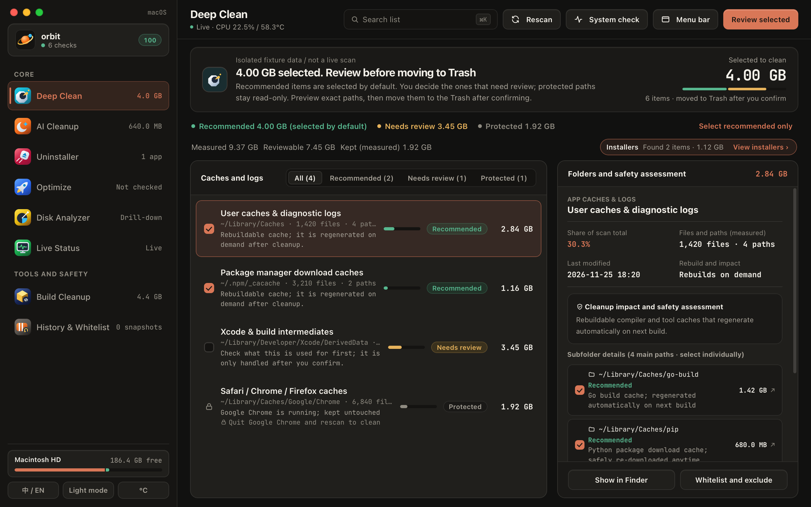
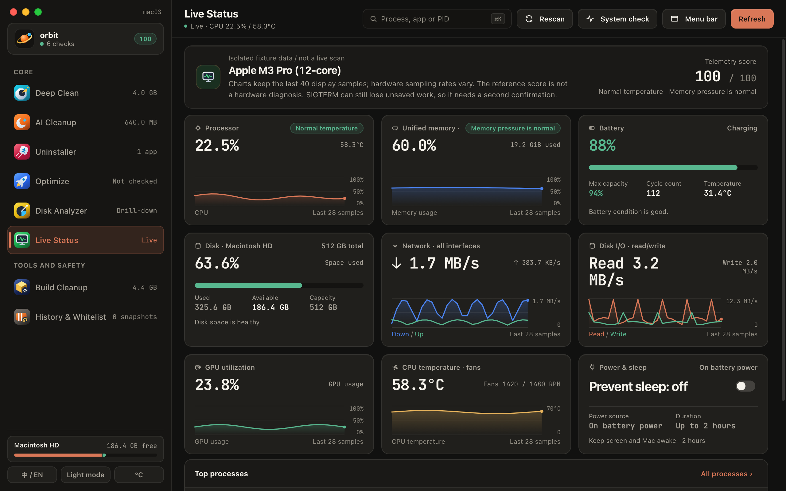
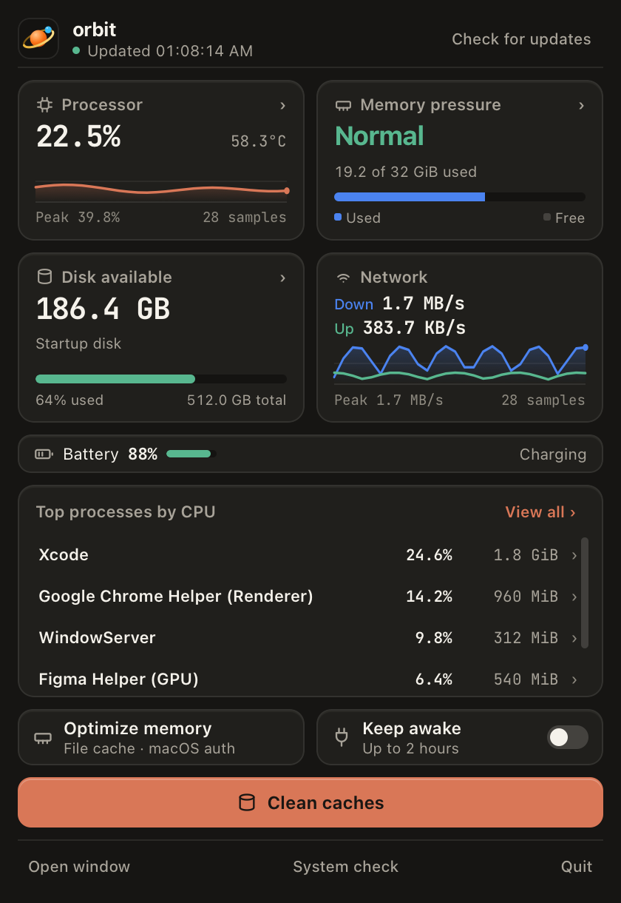
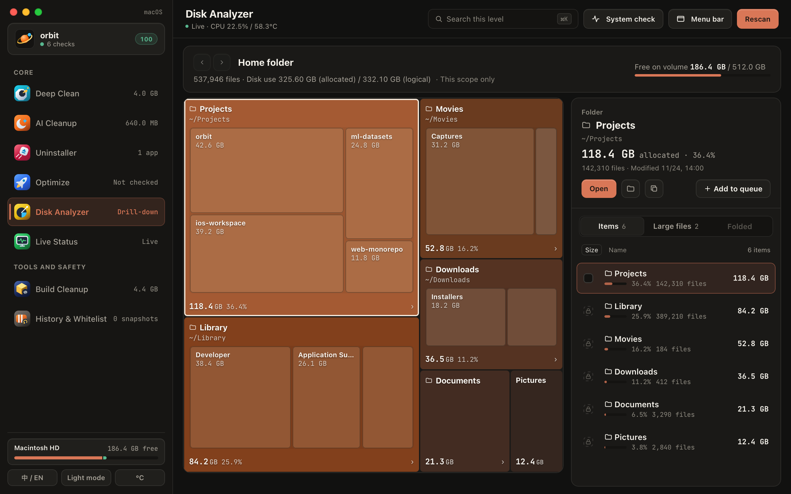

<div align="center">


# orbit

**轻量、安全优先的 macOS 磁盘清理、应用卸载与系统监控工具。**

原生 Go · MyGo · WKWebView 驱动 — 无 Electron，无内置运行时。

[English](README.md) · **简体中文**

[](https://github.com/real-jacket/orbit/releases/latest)
[](https://github.com/real-jacket/orbit/actions/workflows/ci.yml)
[](#环境要求与源码构建)
[](go.mod)
[](LICENSE)
[](https://awesomemygo.dev/apps/orbit)

<br>

<picture>
  <source media="(prefers-color-scheme: dark)" srcset="assets/screenshots/clean-dark.png">
  <source media="(prefers-color-scheme: light)" srcset="assets/screenshots/clean-light.png">
  
</picture>

</div>

---

## 下载与安装

前往 [GitHub Releases](https://github.com/real-jacket/orbit/releases/latest) 下载最新的通用安装包（同时支持 Apple Silicon 与 Intel）：

1. 打开 `orbit-<version>-universal.dmg`，将 **`orbit.app`** 拖入 **`应用程序（/Applications）`**。
2. 正式版使用固定自签名证书（`orbit Self-Signed`）签名，升级版本不会丢失「完全磁盘访问权限」，但未经 Apple 公证。首次打开请右键应用 → **打开**，或在终端执行：
   ```bash
   xattr -dr com.apple.quarantine /Applications/orbit.app
   ```
3. 后续版本支持应用内自动检查更新（Ed25519 签名校验，直连 GitHub Releases）。

> **说明**：应用包名为 `orbit.app`，Bundle ID 保持 `com.mymoles.mole-studio` 不变，早期 `MoleStudio` 版本的授权与白名单会自动继承。

---

## 核心功能

orbit 帮你清楚定位 Mac 上的磁盘占用并安全释放空间：系统与开发缓存、AI 编程工具旧版本、已安装应用与卸载残留、可重建的项目构建产物、旧安装包及大文件；同时内置交互式空间分析地图、实时硬件监控与后台常驻菜单栏弹窗。

| 模块 | 功能说明 |
| --- | --- |
| **深度清理** | 扫描用户缓存与日志、浏览器缓存、包管理器、Xcode、Gradle/CocoaPods 及系统状态；运行中的应用缓存自动受保护；检测到残留安装包时在顶部紧凑胶囊条直接提示。 |
| **AI 清理** | 核验 Claude Code、Cursor Agent、Copilot CLI 与 Claude Desktop 的启动器、运行进程与占用句柄，仅清理确认多余的旧版本；始终保留当前版与备用版，模型与工作成果默认受保护。 |
| **应用卸载** | 支持 **标准卸载 / 彻底卸载 / 仅清缓存** 三种模式，按子路径勾选；自动停用/还原用户级后台服务、审计残留配置引用、发现已卸载应用残留（存在 `docker` CLI / OrbStack 等共享工具时自动保护 `~/.docker`），并支持通用应用瘦身（仅留 Apple 芯片代码）。 |
| **系统加速** | 涵盖 19 项 macOS 维护检查：先检查再决定，10 项可执行任务全部带执行回执并支持一键撤销；需要管理员权限或不可还原的项目只做透明说明，绝不静默执行。 |
| **空间分析** | 进程内高速目录扫描与交互式矩形树图，同时统计实际分配体积与逻辑体积，支持硬链接去重、当前层搜索、小项目折叠查看与批量待清理队列。 |
| **状态监控** | 实时采样处理器、统一内存分类、GPU、AppleSMC 温度与风扇转速、网络速率、磁盘读写、电池健康度、2 小时防休眠开关，以及支持搜索/置顶/退出的全部进程抽屉。 |
| **构建清理** | 扫描默认或自定义项目目录（保存在 `~/.config/mole/purge_paths`）下可重建的 `node_modules`、`target`、`.venv` 等构建产物，以及残留 `.dmg`/`.pkg` 安装包。 |
| **历史与白名单** | 按真实废纸篓清单还原历史清理并实时核验在位状态，支持按「全部 / 可还原 / 需检查」筛选；保护路径白名单（`~/.config/mole/whitelist`）支持原生访达选目录、通配规则标识与一键清理无效条目。 |

---

## 界面一览

<table>
  <tr>
    <td width="64%" valign="top">
      <picture>
        <source media="(prefers-color-scheme: dark)" srcset="assets/screenshots/status-dark.png">
        <source media="(prefers-color-scheme: light)" srcset="assets/screenshots/status-light.png">
        
      </picture>
      <p align="center"><sub><b>状态监控</b> — 处理器、内存、GPU、SMC 温度风扇、磁盘读写、网络与进程管理</sub></p>
    </td>
    <td width="36%" valign="top">
      <picture>
        <source media="(prefers-color-scheme: dark)" srcset="assets/screenshots/menubar-dark.png">
        <source media="(prefers-color-scheme: light)" srcset="assets/screenshots/menubar-light.png">
        
      </picture>
      <p align="center"><sub><b>常驻菜单栏</b> — 关闭窗口或从 Dock 退出后自动常驻菜单栏后台运行</sub></p>
    </td>
  </tr>
  <tr>
    <td colspan="2" valign="top">
      <picture>
        <source media="(prefers-color-scheme: dark)" srcset="assets/screenshots/analyze-dark.png">
        <source media="(prefers-color-scheme: light)" srcset="assets/screenshots/analyze-light.png">
        
      </picture>
      <p align="center"><sub><b>空间分析</b> — 分配/逻辑双体积统计与多级钻取树图</sub></p>
    </td>
  </tr>
</table>

### 特色体验

- **常驻菜单栏后台运行**：关闭主窗口（`⌘W`）或从 Dock 退出（`⌘Q`）后，自动隐藏主窗口与 Dock 图标，继续常驻顶部菜单栏；随时点菜单栏图标恢复窗口，点击菜单栏「退出 orbit」或按 `⌘⌥Q` 才彻底退出进程。
- **可行动的系统体检**：顶部汇总体检结论与遥测参考分，异常项自动置顶，并提供一键直达处理（磁盘不足直达深度清理/空间分析、未授权直达系统设置、内存偏高一键释放文件缓存、热压力偏高直达高耗进程）。
- **逐路径安全检视器**：选中任意分类即可查看子目录明细、体积占比、重建影响说明，支持一键在访达中定位或直接移入白名单。
- **中英双语 & 深浅主题**：侧栏一键切换中/英文与深色/浅色主题，遵循系统减弱动态效果设置。

---

## 安全模型

清理工具的核心是边界清晰、可控可回退：

1. **三级安全分类**：所有条目明确分为 **推荐清理**（可重建且未占用，默认勾选）、**需确认**（说明原因后由你决定）与 **受保护**（只读不可勾选，运行中的应用会提示退出后可清理）。
2. **执行前冻结预览**：点击主按钮先展示精确路径清单并冻结本次勾选，确认后才执行。
3. **仅移入废纸篓，绝不静默硬删**：清理动作全部走 macOS 废纸篓并等待原生回执，历史页保留清单支持原路还原；orbit 永远不会清空废纸篓。
4. **不私自提权**：管理员权限安装的应用交由访达处理；需要 `sudo` 的系统维护项只列明原因不执行。唯一会弹系统管理员授权的是你主动点击的「优化内存」（`/usr/sbin/purge` 释放文件缓存）。
5. **可撤销改动与白名单保护**：系统加速的可逆偏好改动会记录旧值支持一键撤销；白名单保存在 `~/.config/mole/whitelist`（与 Mole 共用）。

---

## 环境要求与源码构建

- **macOS 13 (Ventura)** 及以上
- **Go 1.27+**（`go.mod` 指定 `go 1.27.3`，首次构建会自动下载对应工具链）
- **Node.js 24+**（仅本地测试与 WebKit 回归需要，打包后的应用零第三方运行时依赖）
- **[MyGo](https://github.com/egoist/mygo) CLI**（可选，未安装时 Makefile 会自动通过 `go run` 使用锁定版本 `v0.6.4`）

```bash
git clone https://github.com/real-jacket/orbit.git
cd orbit

make run            # 构建并启动稳定的 orbit.app（推荐日常开发）
make dev            # 启动热重载开发模式
make app            # 打包 orbit.app 与 .dmg 到 build/<goos>-<goarch>/
make app-nodmg      # 仅打包 orbit.app
make check          # 执行 go vet、Go 单元测试及前端/多语言回归检查
make test-ui-webkit # 运行全量 587 项 macOS WebKit 布局与交互回归测试
make mole-sync      # 对比上游 tw93/mole 规则变动
make doctor         # 检查本地 Go / MyGo 打包环境
```

---

## CI 与自动发版

- **CI（[`.github/workflows/ci.yml`](.github/workflows/ci.yml)）**：每次推送或 PR 在单台 `macos-latest` 上完整运行 `gofmt`、`go vet`、`mygo generate` 一致性校验、Go 单元与 `-race` 测试、全部前端与多语言回归、587 项 WebKit 检查以及 `.app` 打包校验。
- **自动发版（[`.github/workflows/release.yml`](.github/workflows/release.yml)）**：在 `main` 分支 CI 通过后自动串联触发（`workflow_run`），先在 `ubuntu-latest` 上快速校验版本号与 [`CHANGELOG.md`](CHANGELOG.md)，仅当存在未发布的新版本时才申请 `macos-latest` 构建签名通用包、校验产物并发布 GitHub Release。

更多架构、权限边界、WebKit 验证与上游对照细节请查看英文版 [README.md](README.md) 及 [`docs/`](docs/) 目录。

---

## 与上游项目的关系

orbit 是独立项目，与 [tw93/mole](https://github.com/tw93/mole) 无隶属或背书关系。部分清理规则最初移植自 Mole `V1.70.0` 并同步适用更新至 `V1.72.0`，遵循上游协议采用 **GPL-3.0** 开源。

## 参与贡献与开源协议

欢迎提交 Issue 与 PR，详见 [CONTRIBUTING.md](CONTRIBUTING.md)。

基于 [GPL-3.0](LICENSE) 协议开源。Copyright (C) 2026 real-jacket.
